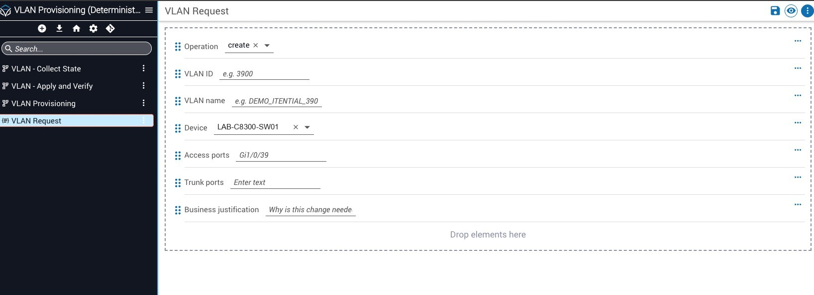
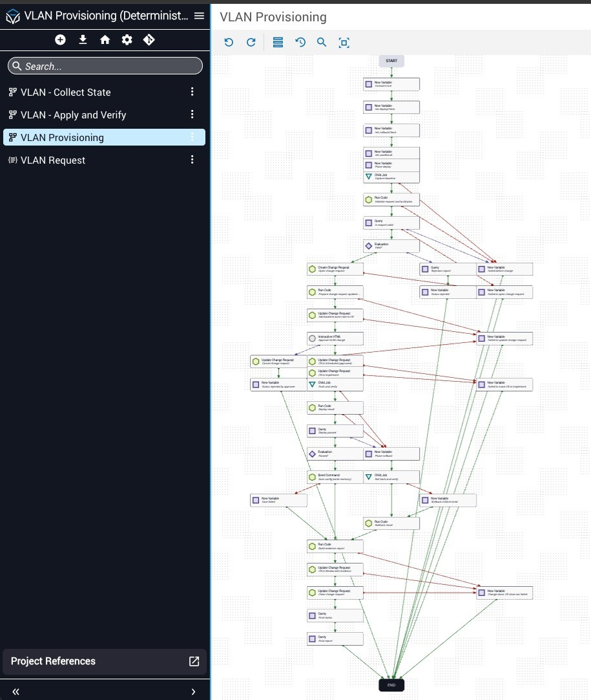
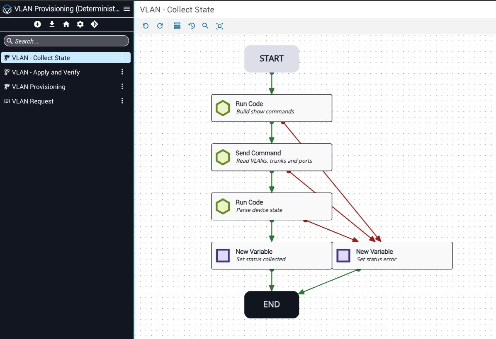
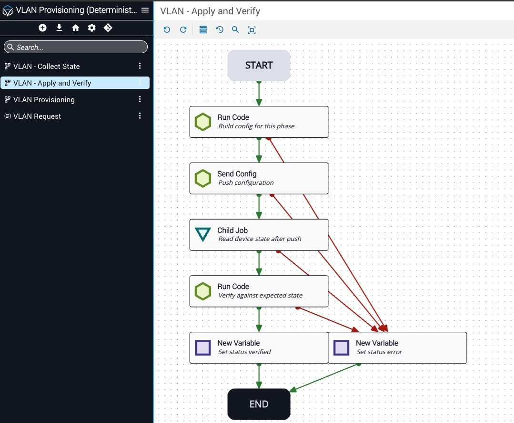

# VLAN Provisioning (Deterministic)

An Itential Platform automation that creates or modifies a VLAN on a Cisco IOS-XE switch, with a ServiceNow change request, a human approval in Work Center, post-change verification and automatic rollback.

No LLM is involved: every decision is plain Python running in `GatewayManager.runCode`, so the same input always produces the same plan.

## What it does

```
Form → Read device state → Validate & plan → Open change request → Approve (Work Center)
     → Push config → Read back & verify → Save config → Report → Close change request
                                  └─ fail → Roll back to baseline → verify
```

1. **Read device state.** `show vlan brief`, `show interfaces trunk` and the running config of every requested port.
2. **Validate the request before touching anything.** Checks:
   - the VLAN ID range;
   - the name rule (`A-Z 0-9 _ -`, max 32);
   - the device allow-list;
   - the VLAN exists or doesn't (as the operation requires);
   - the ports exist and are switchports, and trunk ports are already trunks.

   An invalid request ends here with reasons. No ticket is opened and nothing is pushed.
3. **Open a ServiceNow change request.** A standard change with implementation, backout and test plans, plus a baseline work note.
4. **Approval in Work Center.** The approver sees the baseline, the exact lines to push and the rollback lines.
   - **Reject:** the change request is Canceled and nothing is pushed.
   - **Approve:** the change request moves to Scheduled and then Implement.
5. **Push and verify.** Access ports get `switchport mode access` and `switchport access vlan <id>`. Trunks only ever get `switchport trunk allowed vlan add <id>`. The device is read back and checked against the expected state, including that every VLAN previously allowed on a trunk is still allowed.
6. **Pass:** `write memory`. **Fail:** the generated rollback lines restore the baseline, which is then re-verified.
7. **Close out.** The evidence report goes to the job output and a change request work note. The change request moves to Review, then Closed with close code Successful, Successful with issues (rolled back) or Unsuccessful (rollback failed).

## Screenshots

| Request form | Main workflow |
|---|---|
|  |  |

| Child: Collect State | Child: Apply and Verify |
|---|---|
|  |  |

## Components

| Component | Type | Purpose |
|---|---|---|
| `VLAN Provisioning` | Workflow (orchestrator) | Validation, change request, approval, deploy/rollback, report |
| `VLAN - Collect State` | Child workflow | `sendCommand` + parse into a state object (used for baseline and post-checks) |
| `VLAN - Apply and Verify` | Child workflow | `sendConfig` the deploy or rollback lines, read back, verify |
| `VLAN Request` | JSON Form | Operator input, used by a manual trigger (`legacyWrapper: false`) |

## Repository layout

```
docs/                customer-spec.md (requirements), feasibility.md, solution-design.md, images/
build/vlan.py        all runCode logic, one script with a mode per step (cmds, parse, plan, crprep, cfg, verify, applied, report)
build/build.py       generates the three workflow documents and project-import.json
build/form.py        creates the VLAN Request JSON form
build/unit_test.py   offline tests of vlan.py against captured device output (build/fixtures/)
build/e2e.py         starts the workflow, completes the Work Center approval via API, prints the evidence
build/job.py, api.py small API helpers (OAuth client-credentials from .env)
build/reimport.sh    rebuild + import + restore membership
build/project-import.json, wf-*.json   the generated artifacts
```

## Set up on your platform

**Prerequisites:**
- Itential Platform 6.5+ with Gateway Manager and a Gateway5 cluster that can run `runCode` and reach the switch.
- The switch in an Inventory Manager inventory.
- A ServiceNow integration from the `ServiceNow Change Management` model.

1. **Credentials.** Copy `.env.example` to `.env` and fill in the platform URL and an OAuth service account. `.env` is git-ignored.
2. **Point it at your environment:**
   - In `build/vlan.py`, set `ALLOW` to the device(s) this automation may change: `{device: {clusterId, inventory}}`. Also set the device enum in `build/form.py`.
   - In `build/build.py`, set `RC_CLUSTER` (the cluster where `runCode` runs). If your ServiceNow integration instance isn't named `ServiceNow`, change `adapter_id`.
3. **Test the logic offline:** `cd build && python3 unit_test.py`.
4. **Membership.** Copy `build/members.example.json` to `build/members.json` and add the account and group IDs that should own or edit the project.
5. **Build and import:** `./build/reimport.sh`. This writes `ids.json` with a new project ID, imports the project and sets membership.
6. **Form and trigger.** Run `python3 build/form.py`. Then add the form to the project, create an Operations Manager automation for `VLAN Provisioning` and a manual trigger that uses the form, with `legacyWrapper: false`.

## Demo input

| Field | Create | Modify |
|---|---|---|
| Operation | `create` | `modify` |
| VLAN ID | `3900` | `3900` |
| VLAN name | `DEMO_ITENTIAL_3900` | `DEMO_ITENTIAL_3900_B` |
| Device | your lab switch | your lab switch |
| Access ports | `Gi1/0/39` | `Gi1/0/38` |
| Trunk ports | *(empty)* | *(empty)* |
| Justification | any text | any text |

Approve the Work Center task. The job's `report` variable and the change request's work notes hold the evidence.

## Tested

The following were tested on a Catalyst 8300 with a switch module (IOS-XE 17.6) against a ServiceNow dev instance:
- **Create:** the change request was Closed / Successful, and the VLAN and port were verified on the device.
- **Modify:** rename plus an added port.
- **Rejected by validation:** no change request was opened.
- **Rejected by the approver:** the change request was Canceled and nothing was pushed.
- **Rollback of both runs:** the baseline was restored and verified.
- **Form-to-workflow mapping:** confirmed through the manual trigger.

**Not yet exercised live:**
- The automatic rollback branch inside the orchestrator (the rollback child itself is tested).
- Trunk ports.
- The path where creating the change request fails.

## Notes and gotchas

- **ServiceNow normal changes** can't move Assess → Implement without ServiceNow's own CAB approval. This build therefore uses a **standard** change, and Work Center is the approval gate.
- **Validator false positives.** `POST /workflow_engine/workflows/validate` flags Enable Query decorators (`type`/`view`/`actor` errors) on this platform build. Import and runtime are fine.
- **Re-importing is a full replace.** Re-importing over an existing project ID replaces all of its components. `reimport.sh` aborts if the project holds anything the build doesn't produce, such as the JSON form.
- **Extended-range VLANs** (1006–4094) need VTP transparent mode on the switch.
